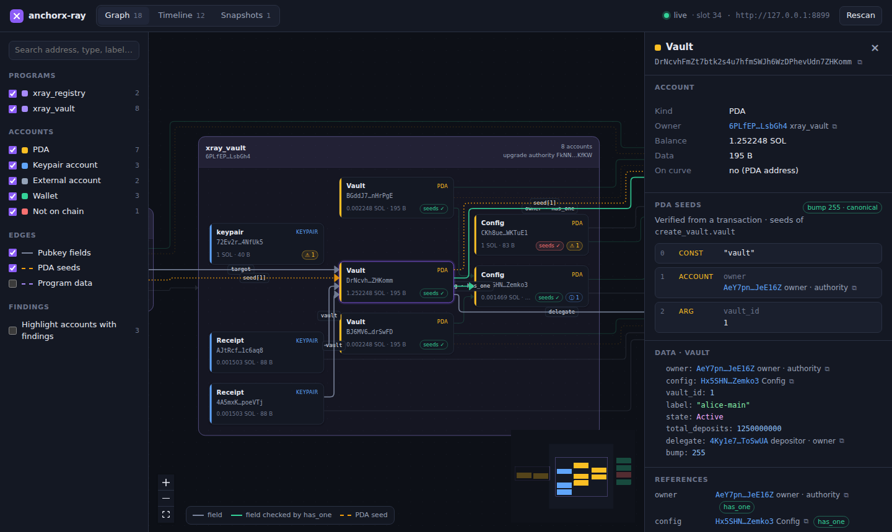

# anchorx-ray

See the on-chain state of your Anchor programs while you test them: every account they own,
the PDAs behind them, how accounts reference each other, and what each transaction changed.



Point it at an Anchor workspace and a running cluster (usually `solana-test-validator`), and it:

- **Maps accounts.** Every account owned by your programs, decoded with the IDL and grouped
  by program. Edges follow `Pubkey` fields and PDA seeds. Fields enforced by `has_one`
  are drawn differently, so an unchecked reference is easy to spot.
- **Re-derives PDAs.** Each off-curve account is checked against the IDL's `seeds`: first
  from the instructions that touched it, then from its own data. You see the seeds, the bump,
  and whether that bump is canonical.
- **Decodes transactions.** Instructions and CPIs with named accounts and arguments,
  `emit!`/`emit_cpi!` events, IDL and Anchor error names, balance changes and logs.
- **Watches live.** Subscribes over websocket, highlights accounts as they change, and shows
  field-level diffs next to the transaction that caused them.
- **Snapshots state.** Save the whole state (for example before a test), then diff it
  against another snapshot or the live cluster, field by field.
- **Flags anomalies.** Non-canonical or mismatched bumps, program-owned data that matches no
  IDL type, off-curve accounts no seed template explains, and fields that point at accounts
  that do not exist.

## Requirements

- Node.js 22 or later
- IDLs in the Anchor 0.30+ format (`metadata.spec`, as produced by `anchor build` since 0.30).
  Convert older IDLs with `anchor idl convert`.
- An RPC endpoint with your programs deployed. A local `solana-test-validator` works best: it
  serves transaction history and websocket subscriptions.

## Usage

Build anchorx-ray from source (see [Development](#development)), then run it from your Anchor
workspace while the validator is up:

```sh
anchor build
solana-test-validator            # or: anchor localnet / anchor test --detach
node /path/to/anchorx-ray/packages/cli/dist/cli.mjs
```

It reads `target/idl/*.json`, takes program ids and the cluster from `Anchor.toml`, and opens
the UI at <http://127.0.0.1:3000>. The server listens on loopback only.

```text
anchorx-ray [command] [options]

Commands:
  ui                     Scan, watch live changes and open the web UI (default)
  scan                   Print the account graph as JSON
  timeline               Print recent decoded transactions
  snapshot <name>        Save the current state as a named snapshot
  snapshots              List saved snapshots
  diff <from> [to]       Diff two snapshots; "live" (default for <to>) is the cluster now

Options:
  -w, --workspace <dir>  Anchor workspace root (default: current directory)
      --idl <file>       IDL file to load; repeatable (default: target/idl/*.json)
      --cluster <name>   localnet | devnet | testnet | mainnet | <url>
      --rpc <url>        RPC URL; overrides --cluster
      --ws <url>         Websocket URL (default: RPC port + 1)
      --tx-limit <n>     Recent transactions to load (default: 100)
  -p, --port <n>         Web UI port (default: 3000)
      --no-open          Do not open a browser
      --no-watch         Do not subscribe to live updates
      --snapshot <name>  ui/scan/timeline: read a saved snapshot instead of the cluster
  -o, --out <file>       scan: write JSON to a file instead of stdout
      --json             timeline/snapshots/diff: print JSON
```

A typical test loop:

```sh
anchorx-ray snapshot before
anchor test --skip-local-validator
anchorx-ray diff before          # what the tests changed, account by account
```

Snapshots are JSON files under `.anchorx-ray/snapshots/` in the workspace. They hold raw
account data and transactions, so `--snapshot <name>` can reopen one without a cluster, for
example to share a failing state with a teammate.

## How it works

- **Account types** come from the IDL discriminators, so decoding never guesses by trying
  every layout.
- **PDA seeds** are recovered in two ways. For every decoded instruction, each account the IDL
  marks with `seeds` is re-derived from that instruction's accounts and arguments
  (`method: transaction`). Accounts that no loaded transaction touched are matched against the
  program's seed templates, using values from their own fields and from observed keys and
  arguments (`method: account-data`). A match is exact: the derived address must equal the
  account's address.
- **`has_one` edges** come from the IDL's `relations`. The IDL does not say which account type
  an instruction account has, so types are learned from transactions, falling back to Anchor's
  naming convention (`vault` → `Vault`).
- **Live diffs** are attributed by slot: an account change is shown on the transactions of the
  same slot that could write that account. When several did, the diff is marked *shared slot*.
- **History** is limited by the RPC node. `solana-test-validator` prunes old slots
  (`--limit-ledger-size`), so on a long-running validator the oldest transactions disappear.

## Findings

| Code | Severity | Meaning |
| --- | --- | --- |
| `pda-noncanonical-bump` | warning | The account is a PDA for these seeds, but not at the canonical bump. |
| `pda-stored-bump-mismatch` | warning | The account's `bump` field differs from the bump that derives its address. |
| `undecodable-account` | warning | Program-owned data whose discriminator or layout matches no IDL account. |
| `pda-unresolved` | info | Off-curve, program-owned account that no seed template reproduces. |
| `dangling-reference` | info | A `Pubkey` field points to an account that does not exist on chain. |
| `program-not-deployed` | info | No executable account at the IDL's address. |

## Development

```sh
pnpm install
pnpm build            # web UI (Vite) + CLI bundle (tsdown) → packages/cli/dist
pnpm check            # oxlint, oxfmt, tsc, unit tests
```

The repository is a pnpm workspace:

- `packages/core`: IDL loading, decoding, PDA resolution, graph, timeline, snapshots, live session
- `packages/cli`: the `anchorx-ray` command and its HTTP/SSE server
- `packages/web`: the React + React Flow UI, laid out with ELK
- `examples/xray-demo`: two Anchor 1.2 programs that exercise PDAs, `has_one`, CPIs,
  events and errors

End-to-end tests start a real `solana-test-validator` with the example programs:

```sh
(cd examples/xray-demo && anchor build)
pnpm test:e2e         # skipped when solana-test-validator or the build is missing
pnpm demo             # seeded validator on :8899 to try the UI against
```

Unit tests run offline on a snapshot recorded by the e2e scenario
(`ANCHORX_RAY_WRITE_FIXTURE=1 pnpm test:e2e` refreshes it). For UI work, run the CLI against
the demo validator and `pnpm --filter @anchorx-ray/web dev`, which proxies `/api` to it.

## License

[AGPL-3.0](LICENSE)
